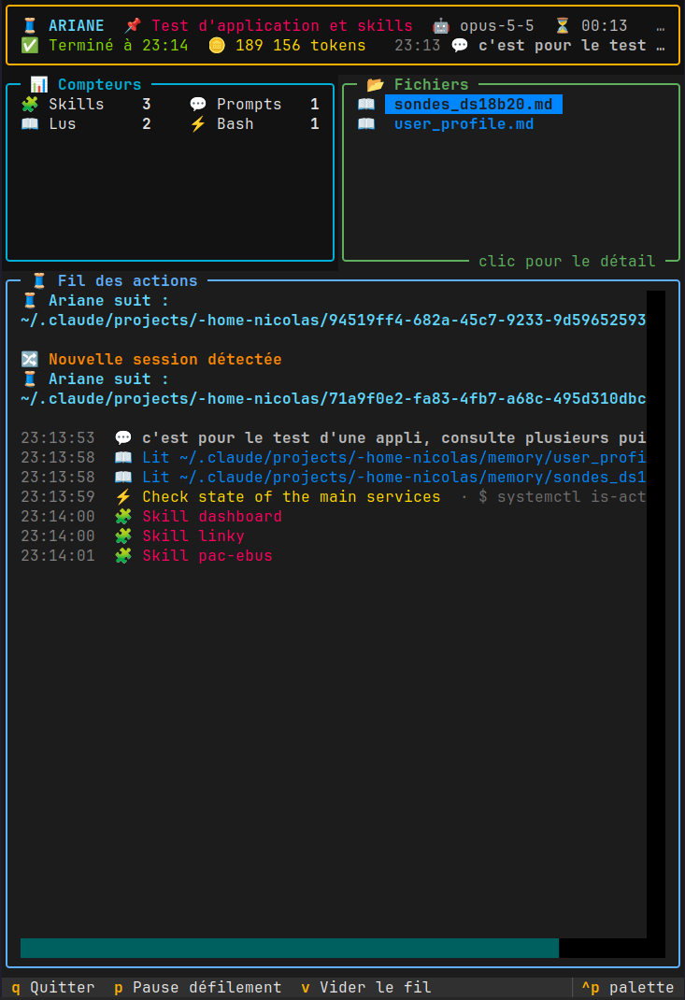

# 🧵 Ariane

**Le fil qui suit Claude Code dans ses méandres.**

Ariane est une application terminal qui affiche en direct tout ce que fait
[Claude Code](https://code.claude.com) pendant qu'il travaille : les fichiers
qu'il lit, modifie ou crée, les commandes qu'il lance, les skills et les
serveurs MCP qu'il utilise, et ce qu'il est en train de faire à la seconde près.

Elle tourne dans n'importe quel terminal, y compris à travers SSH, et ne
consomme aucun token : elle ne fait que lire ce que Claude Code écrit déjà
sur la machine.

<p align="center">
  
</p>

## Ce qu'on voit

- **Bandeau** : titre de la session, modèle, durée, total de tokens, dernière
  demande, et statut en direct (🧠 réfléchit, ⚙️ exécute un outil avec chrono,
  ✋ attend ton autorisation, ✅ terminé).
- **Compteurs** : prompts, lectures, modifications, commandes Bash, recherches,
  skills, sous-agents, MCP, erreurs.
- **Fichiers** : tous les fichiers touchés, colorés selon l'action.
  Un clic ouvre leur historique, le diff des modifications de Claude et leur
  contenu actuel avec coloration syntaxique.
- **Fil des actions** : la chronologie complète de la session.

## Comment ça marche

Ariane combine deux sources d'information locales :

1. **Les transcripts** que Claude Code enregistre dans `~/.claude/projects/`
   (le détail de chaque action, les tokens, le titre de session).
2. **Les hooks** de Claude Code, qui signalent chaque événement au moment où
   il se produit (début et fin d'un outil, demande de permission, fin de
   réponse). Le script `hook.sh` tourne en arrière-plan, n'affiche rien et ne
   ralentit pas Claude.

Sans hooks, Ariane fonctionne quand même, avec un statut moins précis.

## Installation

Prérequis : Python 3.9 ou plus, `jq` et `tmux`.

```bash
git clone https://github.com/NicoPi-dev/ariane.git ~/ariane
cd ~/ariane
python3 -m venv .venv
.venv/bin/pip install -r requirements.txt
chmod +x hook.sh lancer.sh
python3 installer_hooks.py          # ajoute les hooks à ~/.claude/settings.json
echo "alias cca='~/ariane/lancer.sh'" >> ~/.bashrc && source ~/.bashrc
```

Relance ensuite Claude Code pour qu'il prenne les hooks en compte.

## Utilisation

```bash
cca                 # Claude Code à gauche, Ariane à droite, dans tmux
cca ~/mon-projet    # idem, Claude Code lancé dans ce dossier
```

Ariane seule :

```bash
.venv/bin/python ariane.py            # rejoue la session active puis la suit
.venv/bin/python ariane.py --direct   # n'affiche que la nouvelle activité
.venv/bin/python ariane.py FICHIER    # rejoue un transcript précis
```

Touches : `q` quitter · `p` pause du défilement · `v` vider le fil ·
clic ou `Entrée` sur un fichier pour son détail · `Échap` pour fermer.

Pour retirer les hooks : `python3 installer_hooks.py --retirer`.

## Les fichiers

| Fichier | Rôle |
|---|---|
| `ariane.py` | L'interface (Textual) |
| `hook.sh` | Le hook appelé par Claude Code |
| `installer_hooks.py` | Ajoute ou retire les hooks dans la configuration |
| `lancer.sh` | Ouvre Claude Code et Ariane côte à côte dans tmux |
| `lecteur.py` | Première version en texte simple, sans interface |
